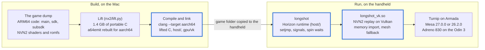
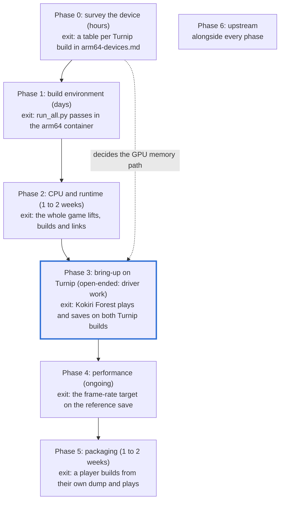

# Longshot on ARM handhelds (Armada OS): port plan

Status: written 2026-11-17 against `main` at `544229a2`. Nothing is implemented yet.

## What we are doing

We are making Longshot build and run natively on aarch64 Linux handhelds running Armada OS. The recompiled game, the
Horizon runtime and the Vulkan back end get compiled for ARM64 instead of x86-64, with no FEX and no emulation of any
kind.

- **Platform:** Armada OS, the SteamOS-like Linux for Snapdragon handhelds, in its game mode and desktop mode.
- **GPU driver:** Armada's own Turnip builds. Mesa 27.0.0 is the main target, and Mesa 26.2.0 must work too. We ship
  no Mesa of our own.
- **Reference device:** AYN Odin 3 (Snapdragon 8 Elite, Adreno 830, 16 GB), the handheld the TotK port was brought up
  on. Snapdragon 8 Gen 2 and 8 Gen 3 devices come after it.
- **Source tree:** the existing Longshot tree, with x86-64 Windows and Linux building exactly as today.

Done means:

1. A game folder for aarch64 is built from the player's own dump and plays on the handheld from Armada's game mode.
2. It boots to the title, starts a New Game, plays Kokiri Forest, and saves and loads, on both Turnip builds.
3. Kokiri Forest holds a steady 30 fps on the Low preset, with an upscaler to the panel's resolution. 60 fps is a
   stretch goal; the number is a first target, set in Phase 4 from measurements.
4. Every change is in a form the Longshot team can take as pull requests, each with its game-free test.

## Decisions and scope

We keep Longshot's static recompiler and change only what ties it to x86-64. Translation layers are off the table: FEX
crashed, and the game's code is ARM64 to begin with.

| Decision | What it means |
| --- | --- |
| One tree for both architectures | aarch64 is chosen by the build target and by `#if defined(__aarch64__)`. The x86-64 Windows and Linux builds stay as they are. |
| Upstream-shaped steps | Each step lands as its own pull request to MagicBeanDev/Longshot, under its rules: a game-free test, `tests/run_all.py`, and a run in the game. |
| Build on the Mac first | `./build_docker.sh` builds the game folder on the Apple Silicon Mac in a native linux/arm64 container (Docker + Nix, as in the TotK port, with the same nixpkgs pin, so the `bbport-nix` store volume serves it too), then the folder is copied to the handheld. Building on the handheld comes in Phase 5. |
| Sysroot no newer than Armada | Binaries link against Ubuntu 24.04's glibc 2.39, so they run on Armada if its glibc is 2.39 or newer (Phase 0 checks). 24.04 rather than the AppImage's 22.04: Longshot's C++ needs libstdc++ 13 (C++20 `<format>`), which 22.04 has only from a PPA. |
| Armada's Turnip only | We test against Armada's Mesa 27.0.0 and 26.2.0 builds (chosen in Armada Control, per game if needed). Driver workarounds are keyed on the driver version, as Longshot already does for other drivers. |
| Two CPU levels | `a64` = `armv8.2-a+lse+rcpc+dotprod`, which the 8 Gen 2, 8 Gen 3 and 8 Elite all run. `oryon` = `-mcpu=oryon-1` for the 8 Elite, kept only if it measures faster. |

Out of scope for now:

- FEX, box64 and any other x86 translation.
- Android, Windows on ARM, and Linux kernels with 16 KB or 64 KB pages.
- GPUs other than Adreno: Mali, PowerVR, and Apple's through Asahi.
- Kernels with a 39-bit address space, unless Phase 0 finds Armada uses one.
- Running the guest code natively instead of recompiling it (Eden's NCE approach).
- DLSS, XeSS and FSR 4, which have no ARM or Adreno version. FSR 3.1 and the simpler upscalers stay.

Longshot's rule carries over unchanged: no game files, keys or anything made from them leave the player's machines. The
Mac and the player's own handheld count as those machines; nothing built from the game goes anywhere else.

## How Longshot works, and why ARM is within reach

Longshot turns the game's ARM64 code into C ahead of time and compiles it for the PC, so the CPU side is mostly a change
of compiler target. The parts tied to x86 are the runtime's few assembly and signal-handling spots, the build and its
tools, and the renderer's assumptions about desktop GPUs.

The boxes with a thick border need ARM work; the others work as they are. The lifted C comes out the same for any host;
what changes is the compiler target, the runtime's edges and the renderer's path to the GPU.

- **Lift:** `nx2/lift.py` turns 17.7 million ARM64 instructions (295,178 functions) into about 1.4 GB of C, using
  a64-kit's lifter and suyu's translator.
- **Build:** `nx2/build.py` compiles that C with clang, together with `host/`, which stands in for the console's system
  software (Horizon). On Linux, `host/posix/` maps the Win32 calls the runtime makes onto POSIX.
- **Run:** the game's NVN2 graphics calls are recorded by `host/nvn_native.c` and replayed on Vulkan by `gpu/vk`
  (`longshot_vk.so`). Its shaders go through Eden's recompiler to SPIR-V.

Why this is within reach:

- The guest and the host would share an instruction set and a memory model, so the game's own code needs no new
  translation.
- a64-kit already has an AArch64 host mode (`RECOMP_FPX_HOST 1` in `arm64_to_c.h`), and every SSE helper in the lifted
  code has a plain-C fallback.
- The Linux runtime exists and is played on several distributions; its fibers use `ucontext`, which works on ARM as it
  is.
- The Vulkan back end treats nearly every extension as optional, and it already samples ASTC natively when the GPU can
  (`vk_formats.cpp`, `astc_native()`). Adreno can.
- Eden's shader recompiler, which Longshot carries, already runs on Adreno GPUs in Eden's Android version.
- The Steam Deck runs Longshot with 16 GB of memory shared by CPU and GPU, at about 21 to 31 fps outdoors on the Low
  preset ([steam-deck-playbook.md](steam-deck-playbook.md)). A 16 GB Snapdragon handheld has the same memory and a
  faster CPU.
- The TotK port already solved the same CPU-side problems on the same handheld, and its build environment and
  profiling tools carry over.

## What has to change

The x86-only code is a short list of mechanical changes, about the size of the TotK port's Phase 2. It comes from a
search of `host/`, `gpu/`, `nx2/`, `third_party/a64-kit`, `scripts/` and `tools.lock` on `main` at `544229a2`.

| Area | Where | Change |
| --- | --- | --- |
| Compiler target and flags | `nx2/build.py` (`-march=x86-64-v3` or `native`, `-mcx16` twice, `IMAGE_LIMIT`'s RIP-relative check), `nx2/host_cpu.py`, `a64-kit/tools/toolchain.py` | An aarch64 Linux target (`--target=aarch64-linux-gnu`, a sysroot), the `a64` and `oryon` levels, `-fsigned-char`, no `-mcx16`. The image-size check gets per-architecture limits. |
| setjmp in lifted code | `host/hos_setjmp.c`: the non-Windows branch is x86-64 System V assembly | AArch64 assembly saving x19-x30, sp, d8-d15 and FPCR. |
| Signals: commit on first touch, the write watch, crash records | `host/posix/win32_posix.c` `context_from` / `context_to` (`REG_RIP`, `REG_RSP`, `REG_ERR`), `host/posix/windows.h` `CONTEXT` | Fill the context from `uc_mcontext.pc`, `sp` and `regs`. Take the write bit from the ESR record in `uc_mcontext.__reserved`. |
| Sampling profiler | `host/posix/prof.c` (`REG_RIP`) | `uc_mcontext.pc`. |
| Spin waits and clocks | `host/hos_thread.c` includes `emmintrin.h` unguarded, which fails to compile. `hos_svc.c`, `nn_os_sync.c`, `gpu/vk/vk_recorder.h` and `vk_internal.h` use `_mm_pause` and `rdtsc` with no ARM branch. | `yield` or `isb` (measured), and `cntvct_el0` for the clock. |
| SIMD helpers | `host/nn_video.c` (NV12 interleave), `gpu/vk/vk_memory.cpp` (AVX2 streaming copy) | They have scalar fallbacks already. NEON versions only if profiles ask. |
| CPU name in reports | `hos_crash_dialog.c`, `vk_bug_report.cpp` (`cpuid`) | `/proc/cpuinfo` and MIDR. |
| Fast-core choice | `hos_thread.c` `last_fastest_core` reads Intel's `/sys/devices/cpu_core/cpus` | Read `cpu_capacity`, so the 8 Gen 2 and 8 Gen 3 little cores are never picked. |
| Fast float regions | `nx2/fastfp.py`: its fast copies rely on x86's MXCSR flags and are left out on other hosts | Works as it is (exact helpers), but slower. An ARM fast path is Phase 4. |
| Translator and unpacker | `a64emit` (suyu's translator, loaded by Python at lift time) and `zbic` ship prebuilt for x86 | Build both for aarch64 (`a64-kit/lift/build_emit.py`, `third_party/zbic`). |
| Prebuilt third-party objects | `nx2/third_party_objects.py`, keyed to x86-64-v3 | Keyed by architecture; aarch64 compiles them until a set ships. |
| Linux tools and packaging | `tools.lock` has only `linux-x64` tools; `scripts/linux/deps.sh`, `appimage.sh` and the AppImage are x86_64 | An aarch64 tool set and AppImage (Phase 5). |
| Play profiles | The lifted code's and the renderer's profiles were recorded on x86 | Kept: a function whose shape differs on ARM simply builds without one. ARM profiles are recorded in Phase 4. |

Two details don't show as x86 code but behave differently on ARM. `char` is unsigned on aarch64 Linux, which
`-fsigned-char` handles. A `volatile` store publishes nothing else on ARM, unlike x86 (see the hard problems).

## The hard problems

The risk sits in the GPU driver and in memory, not in the CPU code. The first two rows decide whether the port is
practical at all, so Phase 0 checks them before any code changes.

| # | Problem | What we know | Approach | Phase |
| --- | --- | --- | --- | --- |
| 1 | The GPU's access to guest memory | `gpu/vk/vk_memory.cpp` `memory_init()` stops without `VK_EXT_external_memory_host`, which Turnip may not have. On Linux the guest window is already a memfd that `/dev/udmabuf` can hand to the GPU as dma-bufs, but only next to host-pointer imports. Pools over udmabuf's 64 MB limit are bound as sparse buffers. | Make host pointers optional and the dma-buf path enough on its own. That needs `CONFIG_UDMABUF`, a usable `/dev/udmabuf`, dma-buf import and sparse binding on Turnip. Fallbacks: `VK_EXT_map_memory_placed`, or a copying mode like TotK's shadow storage. Atomics need a cached, coherent memory type. | 0, 3 |
| 2 | RAM | The game alone uses 13 to 19 GiB on Linux PCs. On a handheld the GPU's memory comes out of the same RAM. The Deck manages with 16 GB on Low. | Zero-copy import (row 1), native ASTC (no decoded copies), and texture and mirror budgets set for shared memory (`texture_budget.h`, `astc_bc_policy.h`, `mirror_budget.h`). 16 GB is the floor; 12 GB only if measurements allow. | 3, 4 |
| 3 | No mesh shaders | Turnip shows no sign of `VK_EXT_mesh_shader`, so the compute fallback runs. It is slower, and it leaves out mesh draws whose count comes from a buffer (`vk_draw.cpp:7217`, issue 640): missing geometry. | Teach the fallback indirect counts, for example a small pass that writes the draw arguments from the count. This helps GTX 10 and RX 5000 players too. | 3 |
| 4 | Renderer CPU cost on a tiler | On a Ryzen 9 7900X the replay alone takes 12.5 ms of a 17.8 ms frame ([design.md](design.md), section 12). The back end was written for desktop GPUs, and Adreno is a tile-based GPU. | Measure first (`HOS_PROFILE=1`, `HOS_CHAIN`), then fewer pass splits and barriers, and the replay on the fast cores. | 4 |
| 5 | Write marks on every store | Every guest store also does two release byte stores (`A64_MARK`). On x86 that is a plain store; on ARM it is `stlrb`, in all 1.4 GB of lifted code. | Plain stores, plus one `membarrier()` before each scan of the marks. Measure against `stlrb`. | 2, 4 |
| 6 | Memory ordering in host code | `host/` has 256 `volatile` uses, and `host/` with `gpu/vk` has 485 relaxed atomics, all only ever run on x86's strong ordering. The capture code already has one known race with the game's threads ([design.md](design.md), section 11). | `-fms-volatile` for the runtime and renderer, as in TotK, then an audit of the flags that publish data, and long runs on the handheld. | 2, 3 |
| 7 | Address space and pages | The guest window is 512 GB, fixed at 16 TB (`A64_HOST_BASE`), so the kernel must give at least 45-bit addresses. 4 KB pages are assumed (the dirty table, commits). | Check in Phase 0. Stop with a clear message on a 39-bit kernel or larger pages. | 0, 2 |
| 8 | Matrix shaders | The movie upscaler and the gameplay TAAU run small networks through HMMA, mapped to `VK_KHR_cooperative_matrix`. Without it, an emulated path runs. Adreno's subgroups are 64 or 128 wide, not 32. | Check the extension in Phase 0, then measure the emulated path on the device. | 0, 4 |
| 9 | Slower float code | The fast float regions are off on ARM (table above), so float-heavy code takes the exact helpers. | ARM's FPU follows the guest's rules: with the host FPCR set to the guest's, the operations can run directly. Gated by `nx2/test_insn.py` and `test_leaf.py`. | 4 |
| 10 | Building on the handheld | A first build compiles 1.4 GB of C. On the Deck it takes "overnight", and it needs about 60 GB free. | Build on the Mac first; an on-device build comes with the AppImage. | 1, 5 |

## The plan

Seven phases, each ending in a check that can fail. Phase 0 comes first because its answers can change Phases 2 and 3.

Phases 0 to 2 are bounded work; Phase 3 depends on what Armada's Turnip builds expose, which Phase 0 finds out.

### Phase 0: survey the handheld and Armada (hours)

- **Kernel and memory:** `uname -r`, `getconf PAGESIZE`, the address-space size (`ARM64_VA_BITS` in
  `/proc/config.gz`), `CONFIG_UDMABUF`, whether the `armada` user can open `/dev/udmabuf`, and its `size_limit_mb`. Also
  the RAM, swap or zram, and free storage.
- **System:** `ldd --version` (glibc: 2.39 or newer for the sysroot of `build_docker.sh`), Python's version, the game-mode compositor (gamescope),
  how Steam starts a non-Steam game, and where its output goes (`~/.local/share/armada/logs`, per the TotK notes).
- **Vulkan, once per Turnip build (27.0.0 and 26.2.0):** `vulkaninfo`. Note these extensions: `external_memory_host`,
  `external_memory_dma_buf`, `external_memory_fd`, `map_memory_placed`, `mesh_shader`, `cooperative_matrix`,
  `graphics_pipeline_library`, `extended_dynamic_state3`, `custom_border_color`, `image_2d_view_of_3d`,
  `conditional_rendering`, `shader_atomic_float` and `present_wait`. Note these features: sparse binding and sparse
  residency for buffers, ASTC and BC textures, geometry shaders, buffer device addresses, the subgroup sizes, and which
  memory types are host-cached and coherent.
- **A probe program, no game files:** it maps 512 GB at 16 TB from a memfd, makes udmabufs from it, imports them into
  Vulkan (sparse too), and checks that the CPU and GPU see each other's writes and atomics.
- **Exit:** `docs/arm64-devices.md` holds a table per driver. Every "no" there is a work item or a stated limit.

### Phase 1: the build environment (days)

Written 2026-11-17, not yet run (it needs Docker on the Mac):

- `build_docker.sh` at the tree's root, after the TotK port's: `./build_docker.sh [--arch aarch64|x86_64]
  [tools|test|game|lock|shell|clean]`. `game` runs `nx2/make_game.py` on `LONGSHOT_GAME` (the `.nup`, or a folder with
  `romfs/` and `exefs/`, mounted read-only) into `LONGSHOT_OUT`, without preparing shaders (no GPU in the container).
  The build runs in a copy of the tree inside a Docker volume, and keeps its lifted C and objects there between runs.
  `LONGSHOT_NIX_VOLUME=bbport-nix` shares the Bloodborne and TotK ports' Nix store.
- `scripts/nix/`: `shell.nix` (the container's tools: Python 3.12 and uv, LLVM 23's tools, rsync, glslang),
  `default.nix` (the target side), `clang-wrapper.sh` and `sysroot_lock.py`.
- The target side is LLVM 23's clang and lld, and an Ubuntu 24.04 sysroot pinned by `scripts/nix/sysroot-<arch>.lock.json`
  (the first run writes it; commit it). FFmpeg with dav1d and SDL2 are built against that sysroot, and the Vulkan,
  SPIR-V and VMA headers are fetched. Their versions and checksums are read from `scripts/linux/deps.sh`, so this build
  and the AppImage's use the same sources.
- The Python packages are `requirements.txt`'s pins as binary wheels. The button-prompt packages are optional: if a
  wheel is missing for aarch64, the game shows the Switch's icons.
- The clang wrapper falls back to the sysroot and lld when a command names neither, because `a64emit` and `zbic` are
  compiled with no target flags (`toolchain.py` `host=True`).
- Still to do here: `nx2/build.py`, `host_cpu.py` and `toolchain.py` learn the aarch64 target and its levels (with
  Phase 2). Until then, `build_docker.sh` passes `RX_MARCH=armv8.2-a+lse+rcpc+dotprod` (`LONGSHOT_CPU`), and the
  aarch64 compile stops at the x86-only code.
- **Exit:** `./build_docker.sh tools` and `./build_docker.sh test` run on the Mac; `tests/run_all.py`'s failures on
  aarch64 are the Phase 2 list; and the runtime and `longshot_vk.so` compile and link for aarch64 without game files.

### Phase 2: the CPU and the runtime (1 to 2 weeks)

- Everything in "What has to change", plus `-fms-volatile`, a start-up check of the CPU features
  (`getauxval(AT_HWCAP)`), and clear messages for a small address space or large pages.
- Write marks: plain stores and a `membarrier()`, kept behind a switch until Phase 4 measures it.
- **Tests:** the game-free checks, then the lift tests on the player's dump in the container. `nx2/test_insn.py` covers
  every instruction form the game uses (742 forms, 44,172 cases against Unicorn). `nx2/test_leaf.py` covers random
  whole functions and call trees.
- **Done (2026-11-17)**, found by the setup AppImage's build on the handheld and by compiling the runtime with its clang:
  - `-mcx16` only for x86-64 targets (`nx2/build.py` `CX16`): clang refused it for aarch64 at the first compile.
  - `host/hos_setjmp.c`: AArch64 `recomp_sj_setjmp` / `recomp_sj_longjmp` (x19-x30, sp, d8-d15, FPCR).
  - `host/hos_thread.c` and `host/posix/windows.h`: the spin pause is `isb` on aarch64, `emmintrin.h` x86-only.
  - `host/posix/win32_posix.c`: the CONTEXT from `pc`, `sp` and `x29`; a fault's write bit from the ESR record.
    `host/posix/prof.c`: the sampled pc from `uc_mcontext.pc`.
  - Checks: `tests/test_arm64_build_flags.py`, `tests/test_arm64_host_code.py` (fail on `b768e07f`, pass here).
  - Compiled for aarch64 without game files: every host runtime file, the lifted runtime (`a64_rt.c`, `a64_suyu.c`,
    `a64_fpx.h`), and the whole Vulkan back end (`RX_VK_ONLY=1`), which links (`longshot_vk.so`, 13 MB).
  - Still open: the lifted chunks and the game's link (need the dump), `host_cpu.py`'s ARM levels (the AppImage sets
    `RX_MARCH`), ARM spin paths in `hos_svc.c` and `nn_os_sync.c` (off on ARM for now), `cntvct_el0` for
    `vk_internal.h`'s clock, and the x86-only test fixtures (`tests/test_split_giants.py` copies the x86 setjmp).
- **Exit:** the whole game lifts, builds and links for aarch64. If Mesa's software Vulkan driver (lavapipe) runs it in
  the container, the game reaches its title there, slowly; otherwise this check moves to Phase 3.

### Phase 3: bring-up on Armada's Turnip (open-ended: driver work)

- Guest memory for the GPU without host pointers (hard problem 1), with the fallback that Phase 0 says is needed.
  - **First run on the Odin 3 (2026-11-17):** the game built on the handheld from the setup window and started with a
    black screen. Its build's shader preparation said why: `vk: no VK_EXT_external_memory_host: the guest memory cannot
    be imported` (Turnip, Mesa 27.0.0-devel, Adreno 830). `memory_init` now takes the dma-buf path alone where there are
    no host pointers (`gpu/vk/vk_memory.cpp`: the window's memfd through `/dev/udmabuf`, a pool past udmabuf's 64 MB in a
    sparse buffer). It needs `/dev/udmabuf` open to the player (`ls -l /dev/udmabuf`; a udev rule with `TAG+="uaccess"`
    otherwise) and sparse binding or a raised `size_limit_mb`. The game's log says which (`vk: guest memory as dma-bufs`).
    If those can't be had, the fallback is TotK's: copies of the written guest memory before each submit.
  - The game's own log under Steam: `logs/longshot_log.txt` in the game folder (`longshot-launch` gives the game no
    stderr when it isn't a terminal: Steam's pipe kept the game from writing it). Crash reports: `bug-reports/`.
- The mesh fallback with indirect counts (hard problem 3).
- Budgets for shared memory; native ASTC confirmed in the log (`vk: ASTC sampled natively`).
- The window and controls under gamescope in game mode, and a launch entry for Steam.
- Order: the title screen, then New Game, then Kokiri Forest, then a save and a reload. Mesa 27.0.0 first, then 26.2.0.
- **Exit:** Kokiri Forest plays and saves on both drivers, with no lost device in 30 minutes.

### Phase 4: performance (ongoing)

- Measure before changing anything: Longshot's profiling mode (`HOS_PROFILE=1`, `scripts/profile_report.py`), the
  frame chain (`HOS_CHAIN`, `scripts/chain.py`), and `perf` on the device.
- Then the likely wins: the write marks, a native-FPCR float mode, the replay and the game's busiest threads on the fast
  cores, fewer pass splits for the tiler, a handheld preset, and play profiles recorded on ARM.
- **Exit:** the frame-rate target from "What we are doing", measured on the reference save.

### Phase 5: packaging for players (1 to 2 weeks)

- **The setup AppImage** (written 2026-11-17, not yet run): `./build_docker.sh setup` makes
  `Longshot-<version>-aarch64.AppImage` with no game files. It is Longshot's own Linux builder
  (`scripts/linux/appimage.sh`), with `LONGSHOT_APPIMAGE_TOOLS` naming build tools made for ARM64, which the image then
  carries at `tools.lock`'s places (`usr/lib/longshot/emsdk`, `sysroot`, `ffmpeg`, `sdl2`; `usr/share/longshot/cpm`).
  There, `builder/linux/linux_tools.py` finds them before it would download anything, so `tools.lock` needs no ARM64
  lines yet.
  - On the handheld: `./Longshot-<version>-aarch64.AppImage --cli --nup game.nup --out ~/Games/Longshot`, then `--play`.
  - **The setup window** (2026-11-17, `builder/linux/setup_ui`): the AppImage started with no arguments (or `--setup`) on
    a display, as Game Mode starts it, opens `usr/bin/longshot-setup`, an SDL2 + Dear ImGui program for the controller,
    touch, a mouse or a keyboard. It picks the `.nup` and the game folder with its own big-row file browser (Home,
    Downloads, Games and the SD card's mounts on the side), runs the AppImage's own `--cli` build, and shows the four
    stages, a progress bar from `make_game.py`'s builder lines (`@@stage`, `@@progress`, `@@plan`, `@@file`, `@@eta`),
    the compile's time left and the live log. When the game is built: Play, and **Add to Steam**, as TotK's installer
    does it (a `Longshot - Ocarina of Time` script in the game folder, then `steam://addnonsteamgame` to the running
    Steam). It remembers its choices in `~/.config/longshot/setup.ini`; full screen under gamescope.
    `build_docker.sh setup` builds it against the sysroot and runs its `--selftest` (every screen offscreen, and a
    stand-in build, `stand_in_build.sh`, through the window to its end). Checks: `tests/test_setup_ui.py`.
  - **Build logs** go next to the AppImage, in `Longshot-logs/build-<date>-<time>.log` (`AppRun` adds `--log` to a
    `--cli` build that names none; `$XDG_STATE_HOME/longshot/logs` when that folder can't be written). The window shows
    the path. The window has its own, `Longshot-logs/setup-window.log` (the run before it kept as `setup-window.prev.log`):
    each step of its start (the session's variables, SDL's video driver, the display, the controllers, the renderer, the
    first frame), the builds it starts and how they end, and everything it and its libraries print, the loader's errors
    too when Steam starts it. Checks: `tests/test_linux_tools.py`.
  - **Game Mode is X11** (found 2026-11-17 with that log): Armada's desktop is Wayland, but gamescope gives the programs it
    runs an X11 display only (`DISPLAY=:1`, `XDG_SESSION_TYPE=x11`, no `WAYLAND_DISPLAY`). The Nix SDL2 had no X11 (nor
    ALSA): nixpkgs' CMake searches no `/usr` of its own, so `find_library` found neither in the sysroot, and SDL2 left
    them out without a word. SDL then took its offscreen driver, and Steam waited for a window for ever. `default.nix`
    now names the sysroot's folders for CMake and stops the SDL2 build when a back end is missing; the window logs SDL's
    video drivers, and gives up (so Steam goes back) instead of drawing offscreen. The game loads the same SDL2.
  - What it carries for ARM64 comes from the TotK port's pinned releases: LLVM 23.1.4's clang and lld (any LLVM 23
    reads the play profiles) and python-build-standalone 3.14 (Longshot's Windows builder runs 3.14 too). FFmpeg, SDL2
    and the headers are built from `deps.sh`'s pins.
  - The clang it carries defaults to the carried sysroot and lld (`clang.cfg`), for `a64emit` and `zbic`.
    `builder/linux/AppRun` sets `RX_MARCH=armv8.2-a+lse+rcpc+dotprod` on aarch64 until `nx2/host_cpu.py` knows ARM's
    levels.
  - It builds a playable game only once Phase 2 is in: until then the build on the device stops at the x86-only code.
- Still to do: aarch64 lines in `tools.lock` and `deps.sh` (then the AppImage need not carry its tools); an on-device
  build within the handheld's memory (`LONGSHOT_JOBS`, `LONGSHOT_MEM_LIMIT_GB`), which the window could offer.
- The Longshot Launcher is a separate project: aarch64 support there is the team's call.
- **Exit:** a player builds from their own dump on the handheld, or on a PC and copies the folder, and plays.

### Phase 6: upstream (alongside every phase)

- Before each piece: the `prior-work` skill's check of the team's pull requests, issues and claims.
- Each piece as a pull request with a game-free test (the `fix-with-test` skill), `tests/run_all.py`, and a note of the
  run on the handheld.
- **Exit:** the aarch64 target lives in Longshot's `main`, and the x86 builds are unchanged.

## Open questions

These are answered by the device, by you, or by the Longshot team, and each changes the plan.

- [ ] Which handhelds besides the Odin 3, and is 16 GB the floor or should 12 GB work?
- [ ] Armada's kernel: address-space size, page size, `CONFIG_UDMABUF`, and whether the `armada` user can open
  `/dev/udmabuf` (Phase 0).
- [ ] Which of the Vulkan extensions in Phase 0 each Turnip build exposes, above all `external_memory_host`, dma-buf
  import, sparse binding, `map_memory_placed`, `mesh_shader` and `cooperative_matrix`.
- [ ] Armada's glibc version: 2.39 or newer, or the sysroot has to go back to 22.04 with the toolchain PPA's libstdc++.
- [ ] Is 27.0.0 a development snapshot (Armada Control's "Devel" build)? If so, which Mesa commit, so results can be
  repeated.
- [ ] The frame-rate target: 30 fps on Low with an upscaler to the panel, or something else?
- [ ] Does the Longshot team want an aarch64 target in `main`, and is anyone already on it (`prior-work`)?
- [ ] Is a build on the Mac, copied to the handheld, enough for players at first, or is the on-device build needed
  early?

## References

- Longshot, `main` at `544229a2`: [design.md](design.md), [development.md](development.md),
  [steam-deck-playbook.md](steam-deck-playbook.md), [AGENTS.md](../AGENTS.md)
- TotK ARM port: [docs/ARM64_PORT_PLAN.md](https://github.com/seregasmith/ARM_Linux_totk_recomp/blob/ARM_Linux/docs/ARM64_PORT_PLAN.md),
  [docs/arm64-performance.md](https://github.com/seregasmith/ARM_Linux_totk_recomp/blob/ARM_Linux/docs/arm64-performance.md)
- Armada OS: [a recent release's notes](https://retrohandhelds.gg/?p=43788), covering Turnip builds chosen in Armada
  Control and custom drivers in `~/.local/share/armada/turnip`
- Mesa: [turnip, vdrm: Implement VK_EXT_map_memory_placed (MR 28928)](https://gitlab.freedesktop.org/mesa/mesa/-/merge_requests/28928).
  Whether Armada's builds expose it is a Phase 0 check.
