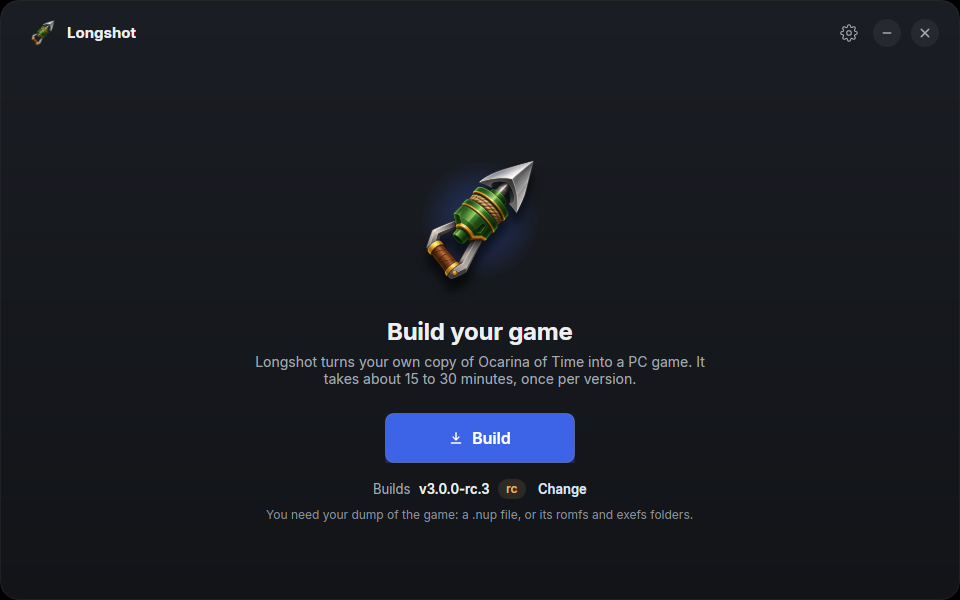
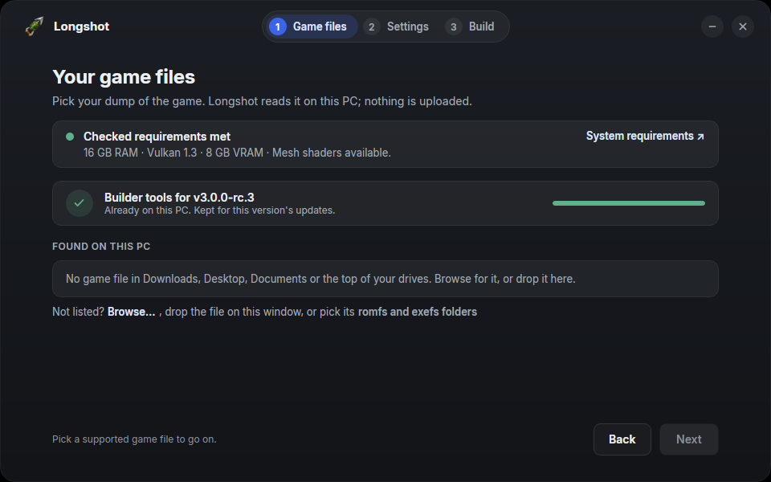

# Getting started

Longshot is built on your PC, from your own copy of the game, by the Longshot Launcher. It takes three steps.
**We do not host, store, or distribute game files, ROMs, game dumps, or decryption keys.**

## 1. Check your PC

Your copy of the game must be the supported version, and your PC needs a Vulkan 1.3 graphics card with 4 GB of video
memory (12 GB and mesh shaders recommended), 16 GB of system memory (32 GB recommended) and about 60 GB free while
building. See the [system requirements](requirements.md).

## 2. Download the launcher

- [Download for Windows](https://longshot.magicbean.dev/download/launcher/windows)
- [Download for Linux](https://longshot.magicbean.dev/download/launcher/linux)
- [Windows, portable zip](https://longshot.magicbean.dev/download/launcher/windows-portable)

**Windows:** run the setup. It asks once: **Install** (for you, no administrator rights, with a Start menu shortcut) or
**Run portable**. The portable zip needs no setup: unzip it and run `LongshotLauncher.exe`; it keeps its data in
`LongshotLauncher-data` beside it, so it can live on an external SSD. Windows may flag the launcher, which isn't
code-signed yet: see [antivirus warnings](https://longshot.magicbean.dev/help/antivirus/).

**Linux and SteamOS:** before opening the `.AppImage`, open its **Properties** in your file manager and enable
**Allow executing file as program** (the wording differs between desktops), or run
`chmod +x LongshotLauncher-*-x86_64.AppImage`. **On a Steam Deck,** read [Playing on the Steam Deck](steam-deck-playbook.md)
before your first build.

Download the launcher, not the builder: the files on Longshot's releases page are what the launcher installs for you.

## 3. Build and play

Press **Build** on the launcher's welcome screen and choose the **Stable** channel.

*Launcher nightly-52-b1d9f7a9 on Linux, UI-only example. The selected game build is illustrative; your version may differ.*

On **Game files**, choose your game from the list: the launcher finds `.nup` files in your Downloads, Desktop and
Documents folders. If yours isn't listed, use **Browse…** to point at the file, or at the `romfs` and `exefs` folders.
Choose **Next** once the launcher has checked your selection; if it reports a different game build, compare its
message with the [supported version](requirements.md).

*Same Launcher example, with illustrative requirements and tools-ready results. Your PC is checked when you use the launcher.*

Choose where the game goes (`Games\Longshot` in your user folder on Windows, `~/Games/Longshot` on Linux, by
default), its language and the options ([build options](advanced.md#build-options)). The launcher downloads this
version's Longshot Builder, checks it against the release's signed checksums, and builds the game: about 15 minutes
on a 12-core desktop, longer on a slower PC. Then press **Play**. The first start prepares the game's shaders, so it's
slower than the next ones. The launcher can also add desktop and Start menu shortcuts (on Linux, an applications menu
entry).

Next: the [settings](graphics-and-controls.md), and [updates and saves](updates-and-saves.md). If something goes
wrong, see [common problems](common-issues.md).
