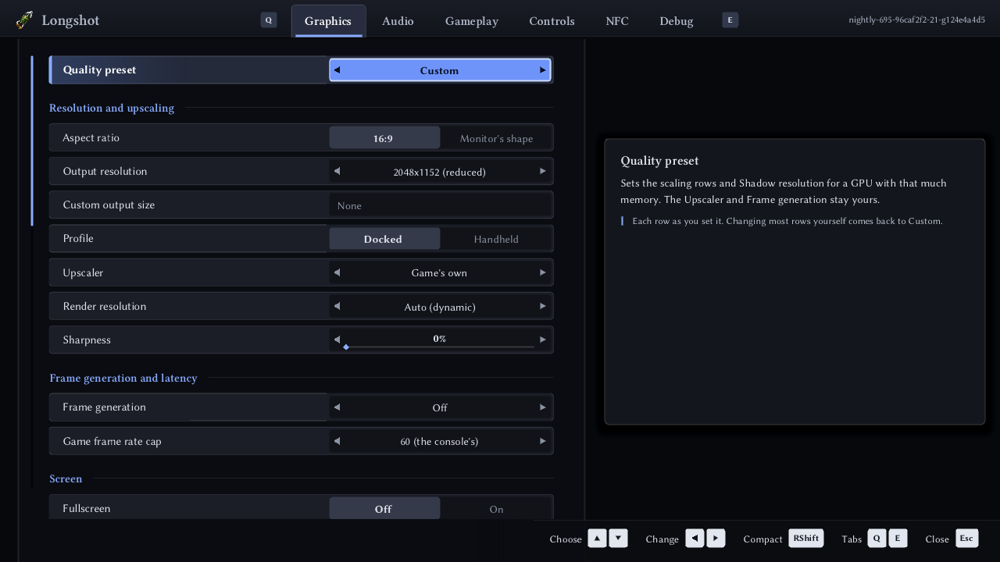

# Settings

Everything you can change while you play is in Longshot's in-game menu: graphics, sound, gameplay and controls. Pick a
starting point below, then look up any single setting in the list.

## Open the menu

| Input | Open or close the menu | Move around it |
|---|---|---|
| **Keyboard** | <kbd>F1</kbd>, <kbd>Insert</kbd> or <kbd>Esc</kbd> | <kbd>Q</kbd> and <kbd>E</kbd> (or <kbd>Tab</kbd> and <kbd>Shift</kbd>+<kbd>Tab</kbd>) switch tabs, the arrow keys choose and change, <kbd>Enter</kbd> changes too, <kbd>Esc</kbd> goes back |
| **Controller** | **Home**, or **Select** and **Start** together (or click the touchpad on a DualShock 4 or DualSense) | LB and RB (or the triggers) switch tabs, the D-pad chooses and changes, A changes and opens a page, B goes back |
| **Mouse** | | Click a tab or a row's name, click the left or right half of a value to lower or raise it, drag a slider, turn the wheel to scroll, right-click to go back |

<kbd>F1</kbd> always opens the menu. **Controls → Menu shortcut** can take <kbd>Esc</kbd> or <kbd>Insert</kbd> off the
list; without <kbd>Esc</kbd>, it only lets the mouse go. A and B are the buttons your **Layout preset** puts the Switch's
A and B on. Beside the rows, the help says what the row does and what the chosen value does.

<a href="images/guide/settings-graphics.png">



</a>

*UI-only example in the Modern dark theme, from 124e4a4d (after nightly 695) on Linux. The Custom values shown are illustrative, not recommended defaults.*

Your choices are saved as you go, in `longshot_options.ini`: in `%APPDATA%\Longshot` when the launcher starts the game
on Windows, so every version shares them, otherwise in the game folder ([where the files go](updates-and-saves.md#where-the-files-go)).
A setting marked **After a restart** applies the next time the game starts: when you close the menu it asks whether to
restart. **Later** keeps the change for next time; **Restart now** starts the game again, and you lose any progress
since your last save.

A row for something your PC can't use is not shown: NVIDIA Reflex and AMD Anti-Lag 2 without a GPU and driver that have
them, the DLSS rows where DLSS doesn't run, the HDR rows while HDR is off.

## Good starting points

A first start uses the **Auto (this PC)** quality preset. It picks settings from your graphics card and its video memory,
then adjusts the render resolution during the first minute of play. If you change nothing, that is what you get. The
Output resolution starts at the game's own 2560x1440, or at your screen's size where that is smaller (a Steam Deck's
1280x800, a 1080p monitor), in your screen's shape: a 2560x1080 ultrawide starts at 2560x1080 and a 2256x1504 laptop at
2256x1504, pixel for pixel. 2048x1152, marked "(reduced)", is the game's own smaller picture, lighter on the GPU.

On supported Windows Vulkan setups, switching from 1280x720 to 1024x576 at 16:9 can preview the new Output resolution
in play. Set **V-Sync** to **On**, enable **Threaded rendering** (its change takes effect at the next launch), and set
**Upscaler** to **Game's own**. Turn off HDR,
frame generation, and NVIDIA Reflex. If 1024x576 is missing from the list, type it in **Custom output size**.
Choose **Yes** within ten seconds to keep the change. **No**, Back, or letting the countdown finish restores the
previous resolution. Other mode changes apply after a restart.

| Your PC | Quality preset | Upscaler and render resolution | Frame rate cap | Frame generation |
|---|---|---|---|---|
| **Steam Deck, handheld, integrated GPU or a 4 to 6 GB card** | Auto (this PC) picks Minimum (4GB); Low (6GB) on a 6 GB card | Game's own, as the preset sets it, or AMD FSR 3.1 at Performance | 60 | Off |
| **Most PCs (8 GB card)** | Auto (this PC) | What Auto chooses: NVIDIA DLSS on an RTX card, AMD FSR 4 on an AMD RDNA 4 card (RX 9000) where the build has it, otherwise the game's own | 60 | Off |
| **A fast PC with a high-refresh monitor** | High (12GB) or Ultra (16GB+) | DLSS or FSR 4 at Quality, or Native (DLAA or FSR 4 Native AA) for the sharpest picture | 60 | 2x or Auto, up to your monitor's refresh rate |

- **Keep the frame rate cap at 60.** Caps from 90 to 240 and Uncapped are experimental: some bosses and cutscenes
  still count frames and can misbehave. For smoother motion, use frame generation instead.
- **Frame generation** adds frames between the game's own. Motion is smoother, but the game itself doesn't run any
  faster and input delay goes up a little. **Auto** matches your display's refresh rate. **NVIDIA Reflex** and **AMD
  Anti-Lag 2** cut the added delay.
- **DLSS and DLAA look softer** than the game's own upscaler: set **Sharpness** to around 80% with them.
- **Ultrawide and 4:3:** leave **Aspect ratio** on your monitor's shape (the default). The 3D fills the screen while the
  HUD keeps its 16:9 size with its corners at the screen's edges (or in the middle, with **HUD layout**); movies stay in
  the middle. **Ultrawide menus** at Extended does the same for the menus: they keep their own size, and what sits at
  their sides (the pause menu's panels, its pages, the item and map screens' side panes) moves out to the screen's edges.
- **HDR:** turn on **HDR** (Expanded or Native), then set **HDR peak brightness** to your monitor's.

## Every setting

Each row of the menu, in the menu's order, with its choices and its default. Labels on a setting say when it applies:
after a restart, only on some GPUs or builds, only while HDR is on, or set for you by a quality preset.

| Tab | Option | Choices | Default |
|---|---|---|---|
| Graphics | Quality preset | Custom, Minimum (4GB), Low (6GB), Balanced (8GB), High (12GB), Ultra (16GB+), Auto (this PC) | Auto (this PC) on a first start; Custom in an options file from before it |
| | Aspect ratio | The shapes your screen's resolutions have, narrowest first (5:4, 4:3, 16:10, 16:9, 21:9, 32:9, ...), your monitor's own marked "(monitor's)" (after a restart) | Your monitor's |
| | Output resolution | The Aspect ratio's sizes: your screen's resolutions and the common ones (1440p, 4K, 5K at 16:9; 1920x1200, 2560x1600 at 16:10; 3440x1440 at 21:9; ...), and 2048x1152 (the game's own reduced size, 80% of its 2560x1440, marked "(reduced)") at 16:9; your screen's own size is marked "(native)" (most changes apply after a restart) | 2560x1440, the game's own picture, or your screen's size where it is smaller (a Steam Deck's 1280x800, a 1080p monitor), at its own shape (a 2560x1080 ultrawide starts at 2560x1080, a 2256x1504 laptop at 2256x1504); Auto (this PC) leaves it as it is |
| | Custom output size | A size of your own, typed as `<width>x<height>` (most changes apply after a restart) | None |
| | Profile | Docked, Handheld (after a restart) | Docked; a quality preset sets it |
| | Upscaler | Game's own, NVIDIA DLSS (only in builds with NVIDIA's DLSS SDK, on NVIDIA RTX GPUs), AMD FSR 3.1 (every build, on GPUs it runs on), AMD FSR 4 (only in builds with FSR 4, on GPUs AMD's files cover), Off (no upscaling), Intel XeSS (Windows, with Intel's `libxess.dll` beside the game). NVIDIA DLAA, AMD FSR 4 Native AA and Intel XeSS Native AA are DLSS's, FSR 4's and XeSS's Native, chosen on the Render resolution row | Game's own; Auto (this PC) chooses DLSS or FSR 4 where they run, never XeSS |
| | DLSS model | Transformer (K) (CNN (E) in its place on cards with less than 7 GB of video memory), Transformer 2 (M), Transformer 2 (L), NVIDIA default, CNN (E), CNN (F) (shown where DLSS runs, with DLSS or DLAA chosen as the Upscaler) | Transformer (K); CNN (E) under 7 GB |
| | FSR 4 model | Auto (AMD's), Lite (INT8) (shown where FSR 4 runs, only in builds with FSR 4's Lite provider). Forcing Lite requires a supported Windows runtime with a verified provider; currently forcing is disabled. Linux retains a saved Lite value but uses Auto. | Auto (AMD's) |
| | DLAA before the bloom | Off, On: where NVIDIA DLAA smooths the picture, after the game's bloom and tone map or before them (shown with NVIDIA DLSS; changeable with Render resolution Native (DLAA) only; changes at once; `RX_VK_DLSS_PRE_BLOOM` over it for one run) | Off |
| | Render resolution | Auto (the game's own dynamic resolution), 100%, 75%, 67%, 50% (each with its size). With DLSS or FSR 4: Auto, Native (DLAA or FSR 4 Native AA: the 3D at full size), 92%, 83%, 75%, Quality (67%), Balanced (58%), Performance (50%), Ultra Performance (33%). With Intel XeSS the same stops, named by the XeSS mode each runs under: Native (XeSS Native AA), Ultra Quality Plus (92%, 83%), 75%, Ultra Quality (67%), Balanced (58%, 50%), Ultra Performance (33%). With FSR 3.1: Auto, 100% (its native AA), then the same as DLSS from 92%. With Off: Auto, 100%, 75%, 67%, 50%, 33% | Auto; a quality preset sets it |
| | Sharpness | 0 to 100%, in steps of 10 | 0%; a quality preset sets it |
| | Frame generation | Off, Auto (it shows who makes its frames: FSR 3.1 FG or Built-in FG), 2x to 8x; with DLSS FG up to what NVIDIA's runtime makes on the GPU (6x on an RTX 50, 2x on an RTX 40) | Off |
| | Frame generation by | Shown while Frame generation is on. DLSS FG (NVIDIA DLSS Frame Generation: RTX 40 and newer, with a temporal Upscaler), FSR 3.1 FG (AMD FSR 3.1's frame interpolation, from the scene's depth and motion: any GPU), Built-in FG. DLSS FG is offered only where it runs; elsewhere the row has FSR 3.1 FG and Built-in FG, and its line at FSR 3.1 FG says why not DLSS FG (the log has NVIDIA's answer). At DLSS FG, FSR 3.1 makes the frames DLSS FG does not (Frame generation's Auto). At DLSS FG, the game's own menus, movies and loading screens show only the game's own frames (they have no Upscaler picture to make frames from): the row's line and the FPS counter say DLSS FG paused. With an Upscaler that is not temporal, the built-in one makes the frames and the line says why. `RX_VK_DLSS_FG=1` fixes the row at DLSS FG for a run. Changes at once | DLSS FG where it runs, else FSR 3.1 FG (an options file's Auto from before is this default) |
| | Game frame rate cap | 30, 60 (the console's), 90, 120, 144, 165, 240, Uncapped (changes at once) | 60 |
| | NVIDIA Reflex | Off, On, On + Boost (shown only on NVIDIA GPUs with `VK_NV_low_latency2`) | Off |
| | AMD Anti-Lag 2 | Off, On (shown only on AMD GPUs with `VK_AMD_anti_lag`) | Off |
| | Fullscreen | Off, On (the same as <kbd>F11</kbd>) | Off |
| | Fullscreen monitor | Auto (current monitor), or a named connected screen. While windowed, chooses the next fullscreen destination; while fullscreen, moves the game. An unavailable choice is retained with a temporary fallback. | Auto (current monitor) |
| | V-Sync | Auto, On, Off | Auto |
| | Window scaling filter | Off, Catmull-Rom, Lanczos (shows "Not needed (window = output)" while the window is the Output resolution's size) | Off; a quality preset sets it |
| | CRT filter | Off, Lottes aperture grille, Lottes consumer TV, Hyllian Fast, zfast CRT (changes at once; Native HDR bypasses it) | Off |
| | CRT lines | 240, 480, 720 virtual lines (shown with a CRT filter on; changes at once; capped at half the destination height) | 240 |
| | Ultrawide menus | Full width; Centred, blurred sides; Centred, black bars; Extended (with the Aspect ratio at the monitor's shape) | Centred, blurred sides |
| | HUD layout | Screen's edges, Middle 16:9 or Custom. `HOS_WIDE_UI`, when set, overrides the choice | Screen's edges |
| | Hearts and magic horizontal | From −15% to +15% of the picture's width (shown with HUD layout set to Custom and no `HOS_WIDE_UI` override) | 0% |
| | Hearts and magic vertical | From −15% to +15% of the picture's height (shown with HUD layout set to Custom and no `HOS_WIDE_UI` override) | 0% |
| | Hearts and magic size | From 75% to 125% (shown with HUD layout set to Custom and no `HOS_WIDE_UI` override) | 100% |
| | Action and item buttons horizontal | From −15% to +15% of the picture's width (shown with HUD layout set to Custom and no `HOS_WIDE_UI` override) | 0% |
| | Action and item buttons vertical | From −15% to +15% of the picture's height (shown with HUD layout set to Custom and no `HOS_WIDE_UI` override) | 0% |
| | Action and item buttons size | From 75% to 125% (shown with HUD layout set to Custom and no `HOS_WIDE_UI` override) | 100% |
| | Minimap horizontal | From −15% to +15% of the picture's width (shown with HUD layout set to Custom and no `HOS_WIDE_UI` override) | 0% |
| | Minimap vertical | From −15% to +15% of the picture's height (shown with HUD layout set to Custom and no `HOS_WIDE_UI` override) | 0% |
| | Minimap size | From 75% to 125% (shown with HUD layout set to Custom and no `HOS_WIDE_UI` override) | 100% |
| | Reset HUD placement | Restores the three groups to their usual positions and sizes (shown with HUD layout set to Custom and no `HOS_WIDE_UI` override) | — |
| | HDR | Off, Expanded, Native (the game's) | Off |
| | HDR paper white | 80 to 400 nits, in steps of 10 (while HDR is on) | 200 nits |
| | HDR peak brightness | 400 to 4000 nits, in steps of 100 (while HDR is on) | 1000 nits |
| | HDR contrast | 50% to 200% around mid grey, in steps of 5 (while HDR is on) | 100% |
| | HDR tone mapper | Vanilla (the game's curve), PsychoV35 (RenoDX's; with HDR set to Native). Compatible DLSS/DLAA, FSR 4/native AA and shared-chain FSR 3.1 upscaling run automatically; `RX_VK_PSYCHOV35_DLSS=0` disables that compatibility route. Off and the spatial/FXAA TAAU replacement support PsychoV35 directly. FSR 3.1 FG remains separately opt-in and 2x only; legacy own-input FSR upscaling remains unsupported | Vanilla |
| | Colour vision correction | Off, Protan (red-green), Deutan (red-green), Tritan (blue-yellow). Changes apply immediately. | Off |
| | ReShade preset | Applies a built-in or imported preset to the gameplay scene before the HUD. Includes twenty Clarity looks for Zelda, depth effects and an HDR preset. See [ReShade FX presets](reshade-presets.md). | Off |
| | Compare ReShade Preset | Opens a compact toolbar to toggle the effect and browse presets. User adds a row for imported INI files. | — |
| | User preset file | A ReShade INI from the profile's `reshade/presets` folder (with User selected). | No preset |
| | Rescan ReShade presets | Refreshes the user preset list and reloads the selected file (with User selected). | — |
| | Anisotropic filtering | Game's, 2x, 4x, 8x, 16x | 16x |
| | Grass distance | Game's, 2x, 3x, 4x: how far the short grass blades reach | Game's |
| | Simulated turf | Opens the area's six-row simulated-turf page: Use global multipliers; Fade start; Turf density; Minimum blades; Far power; Reset current area. With global multipliers on, the four value rows become multipliers of each area's installed profile. Fade start and Minimum blades can both be 0 for no simulated turf. Changes apply at once and save per area in `sim_turf_settings.ini`. | Each area's installed profile |
| | Shadow resolution | Auto (for the card's memory), Game's (1600), High (2200), Highest (3072): the sun's shadow maps, applies at once; Highest also keeps the nearest shadows from shimmering as much | Auto |
| | GPU device | Auto, or each graphics card by name (after a restart) | Auto |
| Audio | Volume | 0 to 100%, in steps of 5 | 100% |
| | Mute in background | Off, On | Off |
| | Output device | Default or a named Windows playback device; applies live | Default |
| | Speaker layout | Auto, Stereo, 5.1, Mono (layout changes after a restart; Mono/Stereo live on stereo output) | Auto |
| | Controller speaker | Opens the Controller speaker page, for a DualSense on a USB cable: Speaker volume (0% to 200%, in steps of 10; 100%), Controller sync (-100 ms to 150 ms, in steps of 10: below 0 the TV waits, above 0 the controller waits; 0 ms), Headphones on the controller (Off, Controller sounds, All sound; All sound), Headphone volume (0% to 100%, in steps of 10; 80%), then where each kind of sound plays (Off, Controller only, Controller + TV): Navi's voice (Controller only), Navi's flight sounds (Controller + TV), Z-targeting (Controller only), Ocarina (Controller + TV), Pick-ups (Controller only), Items (Controller + TV), Fairies (Controller + TV), Menu sounds (Controller only), Stone of Agony (Controller only), Low health alarm (Controller only), Fishing (Controller only), Bottles (Controller only) | |
| | Microphone | Off, Default, or each microphone by name | Default |
| | Microphone gain | Software input level, 0–400%; applies to new samples without changing system volume | 100% |
| | Test microphone | Start/stop capture; live levels appear in the help box for Test microphone and Microphone gain | Stopped |
| Gameplay | FPS counter | Off, FPS, Frame time, Graph, Breakdown, Dev | Off |
| | FPS counter position | Top right, Top left, Bottom right, Bottom left | Top right |
| | FPS counter size | Auto, Small, Medium, Large | Auto |
| | FPS counter details | Opens the FPS counter details page: Version and hardware at every level (Off, On; Off), then a line each of the Dev level (VRAM, Textures, Draws, Dispatches, Render passes, Draws skipped, Texture uploads, Pipelines built, GPU slot waits, Queue submits, Write-backs) and the footer's CPU and GPU lines and its render lines: the resolution the 3D is drawn at and what upscales it (Off, On; On each) | Version and hardware off, every line on |
| | Menu size | Small, Medium, Large | Medium |
| | Menu theme | Modern dark, Classic (the game's own tan and gold); the menu, the FPS counter and the start-up screen | Modern dark |
| | Game speed | Per frame, Real time | Real time |
| | Field of view | 50% to 150%, in steps of 5; applies immediately during gameplay | 100% (original) |
| | Text speed | Normal, 2x, 4x, Instant | Normal |
| | Text size | Original, 110%, 125%, 150%, 175% (dialogue, Navi and signs) | Original |
| | Skip title screen | Off, On (after a restart) | Off |
| | Game language | The game's 16 languages, each by its own name (after a restart) | `language.txt`'s, else English (US) |
| | Menu language | Auto (the game's language), or English, Português (Brasil), Español (Latinoamérica), Español (España), Français, Deutsch, Italiano, Nederlands, Polski, Русский, 日本語, 한국어, 简体中文, 繁體中文 | Auto |
| | Discord status | Off, On ("Playing Longshot" and the time played in your Discord status, while Discord runs on this PC) | On |
| | Skip opening | Off, On (skips the new-game opening: the story movie and Navi waking Link; later cutscenes and the title screen stay) | Off |
| | Bug report | Saves a report into a new folder in `bug-reports` | |
| Controls | Controller in background | Off, On | Off |
| | Mouse camera | As the stick, Native, Off | As the stick |
| | Disable camera centering | Off, On | Off |
| | Mouse sensitivity | 0.10 to 5.00, in steps of 0.10 | 1.00 |
| | Invert mouse vertical | Off, On | Off |
| | Invert mouse horizontal | Off, On | Off |
| | Invert camera X | Off, On | Off |
| | Invert camera Y | Off, On | Off |
| | Camera speed | 50% to 400%, in steps of 25 | 100% |
| | Stick dead zone | Default (24%), 5%, 10%, 15%, 20%, 30% | Default (24%) |
| | Vibration | Auto, Basic, Off | Auto |
| | Vibration strength | 25% to 200%, in steps of 25 | 100% |
| | Test vibration | an action: Confirm buzzes the controller used last; the value says what plays it | Motors |
| | DualSense HD Haptics | On, Off | On |
| | Layout preset | Nintendo (Def), Xbox / PC, Swap Face, Switch 2 Pro; Custom once you bind a button yourself (on the Controls page) | Nintendo (Def) |
| | Button prompts | Auto, Switch, Xbox, PlayStation 4, PlayStation 5, Steam Deck, Keyboard (on the Controls page; changes at once where the game allows it, else after a restart) | Auto |
| | Motion | Opens the Motion page: Motion controls (Off, On; On), Motion sensitivity X (10% to 600%) and Y (10% to 300%, in steps of 10; 100%), Invert motion X and Y (Off, On; Off), Motion deadzone (Low, Standard, High; Standard) | |
| | Walk mode | Hold, Toggle | Hold |
| | Walk speed | 15% to 90%, in steps of 5 | 45% |
| | Sprint | Off, On (a press of <kbd>Shift</kbd> or the left stick pressed in makes Link run, without rolling, until he stops or does something else; the Controls page's Toggle cell, on by default, turns off to sprint only while you hold it; turning Sprint on moves Shift and the left stick's press to Sprint) | Off |
| | Controls | Opens the Controls page | |
| | Menu shortcut | Insert or F1; F1 only; Insert, F1 or Esc | Insert, F1 or Esc |
| | Controller menu button | None, Home, Back left (GL), Back right (GR) | Home |
| | Compact menu key | Right Shift, Right Ctrl | Right Shift |
| NFC | NFC tag | The tag files of your NFC folder, by their names | The first |
| | Tap tag | Holds the chosen tag to the game's reader | |
| | Remove tag | Takes it off the reader | |
| | Scan tag on controller | Reads a tag you own with a Switch 2 Pro Controller (USB) and saves it in your NFC folder | |
| Debug | Debug tools | Off, On (while on, the tools below it: Heart protection, No-clip flight, Mark position, Return to mark, Set time, Inventory item, Change quantity, Free camera, Teleport, Switch age, Inventory, Movement speed) | Off |
| | Autosave: | On or Off, available with Debug tools off. Enabling Debug tools switches Autosave to Off. Off skips supported autosaves, including the verified map transitions. You can still save manually. | On |
| | Player: Damage taken | Half, Normal, Double, Quadruple (live, while Debug tools is on; Half rounds damage up to a quarter heart; Heart protection wins) | Normal |
| | Developer: Save my pipeline list | Saves a zip of the pipelines your play built into Downloads ([send your pipeline list](reporting-and-contributing.md#send-your-pipeline-list)) | |
| | Developer: Frame pacing | Off, On | Off; a quality preset turns it on |
| | Developer: Threaded rendering | Auto, On, Off (after a restart). Auto is On with 6 or more processor cores for the game, and the render thread alone with 4 or 5 | Auto |
| | Developer: Descriptor reuse | Off, On (changes at once) | On |
| | Developer: Sampler cache | Off, On (changes at once) | Off |
| | Developer: Robust buffers | Auto, Off, On (after a restart) | Auto |
| | Developer: Present queue | Off, On (after a restart) | Off |
| | Developer: ASTC as RGBA8 | Off, On (after a restart) | Off |
| | Developer: Intel shader compiles | Auto, Side by side, One at a time (after a restart; Intel graphics on Windows only) | Auto |
| | Developer: Intel quick compute builds | Off, On (changes at once; Intel graphics on Windows only) | On |
| | Developer: Set up for a weak laptop | Sets the rows for integrated graphics with 4 CPU threads or fewer (shown on integrated graphics only) | |
| | Input recording: Record input | Records your input from Link's next update until you press it again: the controller, motion, the mouse camera, and the Debug tools' teleports and switches. The file goes in your folder, `recordings/`. For tests and bug reports | |
| | Input recording: Play recording | Opens a page: Stop playback while one plays, Last recording, then your recordings, newest first. Link is taken to a recording's age and map and put where it started; your controller does nothing for the game until it ends or you stop it, and the menu turns compact so you can watch | |
| | Input recording: Drift correction | Off, Every update, Every second, Every 5 s: how often a replay puts Link and the camera back on the recording while they are within 1 m of it | Every update |

For a live preview while adjusting Custom HUD placement, use the compact menu. Right Shift switches to it by default.

The **Debug** tab is for testing. Its **Debug tools** (or `HOS_OOT_CHEATS=1` in `longshot_env.txt`) add flight, a free
camera, teleport, the inventory and the other tools below the row. Its **Developer** rows are workarounds to try when a
helper asks you to.

## About some settings

- **Colour vision correction:** in **Graphics → Accessibility**, choose **Off**, **Protan (red-green)**,
  **Deutan (red-green)** or **Tritan (blue-yellow)**. The setting takes effect immediately and is remembered.
  It shifts colour differences while preserving brightness. The three modes are fixed presets and their
  usefulness varies by player and scene.

- **Quality preset** sets Render resolution, Window scaling filter, Sharpness, Frame pacing, Game speed, Profile and
  Shadow resolution for a card with that much memory. It leaves the Upscaler and Frame generation as you chose them:
  with DLSS, FSR 3.1 or FSR 4, the preset's resolution becomes their nearest mode. Changing most other rows yourself
  sets it to Custom.
- **Simulated turf** controls the large-scale, flowing turf made by an area's fluid/turf simulation and keeps
  a separate profile for each visited area. Leave **Use global multipliers** off to edit that area's Fade start, Turf
  density, Minimum blades and Far power directly; turn it on to scale every area's installed values instead. **Reset
  current area** removes only the current area's edits. Setting Fade start and Minimum blades to 0 disables its simulated
  turf for lower-end systems; flowers, shrubs and the short decorative blades controlled by **Grass distance** can remain.
  The renderer measures the resulting turf-list demand and grows its record capacity with headroom when an area needs
  more than the game's own lists hold; sustained lower demand releases that extra capacity, down to the game's own size.
- **Auto (this PC)** chooses for the PC it runs on: the memory tier from the card's video memory (Minimum on an
  integrated GPU, a Steam Deck or a card without mesh shaders), DLSS on an NVIDIA RTX card or FSR 4 on an AMD RDNA 4 card (RX 9000)
  where the build has them. In the first minute of play it lowers the Render resolution a step while frames are missed
  with the GPU busy, or raises it while the cap holds with the GPU under half busy: at most two steps. It chooses again
  when the card or the screen changes; `longshot_log.txt`'s `Auto (this PC)` lines say what it chose and why.
- **The scaling rows**, in the picture's order: **Output resolution** is the size of the whole frame, HUD included. The
  **Upscaler** fills it from the 3D, whose share is the **Render resolution**. **Off** is no upscaler at all, not even
  the game's own: the fastest choice, with jagged edges. The **Window scaling filter** then scales the frame to your
  window, and **Sharpness** sharpens it. For the sharpest picture, set the Output resolution to your screen's size: the
  filter row then shows "Not needed (window = output)". NVIDIA DLSS, AMD FSR 4 and Intel XeSS need files of their
  makers' ([optional upscalers](advanced.md#optional-upscalers)); AMD FSR 3.1 is in every build.
  For a non-AI alternative to the game's own upscaler, choose **Off** on the Upscaler row and select a smaller Render
  resolution. This stretches the picture with a linear filter; its appearance and performance differ from the game's network.
- **Aspect ratio** lists the shapes of your screen's resolutions, your monitor's own marked "(monitor's)", and **Output
  resolution** that shape's sizes, your screen's own marked "(native)". A size larger than your screen is drawn at that
  size and scaled down. For a size the menu doesn't offer, type it in **Custom output size** (`<width>x<height>`, each
  side a multiple of 8, from 640x360 up to 5120x2880's pixels, between 5:4 and 48:9); the menu says why it refuses one.
  For three 16:9 monitors, use `5760x1080` or `7680x1440` with a window that spans all three.
- **Frame generation by** chooses who makes the extra frames: **DLSS FG** (NVIDIA DLSS Frame Generation, RTX 40 and
  newer, the default where it runs: up to 6x on an RTX 50, 2x on an RTX 40), **FSR 3.1 FG** (AMD's, on any GPU, the
  default elsewhere) or **Built-in FG**. **Frame pacing** (Debug tab) shows those frames at an even interval: less
  stutter, up to a frame of delay. **Present queue** (Debug tab) can make them more even with V-Sync Off on some cards,
  but lost the GPU on others: if the game then crashes before you reach the menu, put `RX_VK_PRESENT_QUEUE=0` in
  `longshot_env.txt`, turn the row off and remove the line.
- **Game frame rate cap** limits the frames the game renders: with a cap of 60 and Frame generation at 2x, the output
  reaches 120 FPS. A cap above 60 is experimental: the game keeps real time, but some cutscenes and bosses count frames
  and can misbehave. **Uncapped** renders as fast as the PC can; with V-Sync on, the display's refresh still holds it.
- **V-Sync:** Auto is mailbox where the driver has it (no tearing, no wait), else On, or Off on Windows. On waits for
  each refresh; Off shows each frame at once and can tear.
- **HDR:** Expanded expands the game's SDR picture; Native is the game's own HDR, with the **HDR tone mapper** row.
  On Windows, if the game stays SDR, the HDR row's help says why ([HDR stays SDR](common-issues.md#windows-hdr-is-on-but-the-game-stays-sdr)).
- **CRT filter** adds scanlines and a phosphor mask to the finished SDR picture, HUD included; **CRT lines** is its
  virtual line count. Native HDR leaves it out.
- **Anisotropic filtering** keeps the ground sharp at a slant; 16x costs little on most cards, and Game's is the
  console's own. **Shadow resolution** sets the sun's shadow maps: Auto picks by the card's memory (the game's 1600 up
  to 6 GB, High at 8 GB, Highest from 12 GB). On Highest the nearest shadows shimmer less while the camera turns or
  Link walks: the map near Link stays put in the world instead of following the view. The steady fit is a little coarser
  than the game's own fit standing still, so below Highest the game's fit is kept ([developer switches](../dev/reference/switches.md)).
- **Grass distance** sets how far the short grass blades reach: the starting forest's tufts and the moss on its stones. The game
  picks patches within 22 m of Link and thins blades by distance from the camera, from 12 m to about 20 m. 2x, 3x and 4x
  extend their radius and fades by that factor. Game's, the default, keeps the console's reach. The change applies at once.
  This row does not change the large-scale simulated turf controlled by **Simulated turf**. Saved as `grass_distance`;
  `RX_VK_GRASS_DISTANCE=<n>` (1 to 8) overrides the row for one run.
- **GPU device** matters on a PC with more than one graphics card: Auto prefers a dedicated one. The card you choose is
  remembered as that card, not its place in the list.
- **Threaded rendering:** On draws the picture on threads of its own (a render thread and a recorder thread) while the
  game goes on to its next frame, for a higher frame rate on a processor with cores to spare; it can still show
  flashes. Auto counts the processor's cores for the game: both threads with 6 or more, the render thread alone with 4
  or 5, Off with fewer. It applies after a restart.
- **Robust buffers** drops a read past a buffer's end instead of stopping the GPU: Auto is on, on every card.
  **ASTC as RGBA8** is the [AMD texture workaround](common-issues.md#amd-blocky-textures-solid-rectangles-in-the-sky-or-dark-courtyard-surfaces).
  **Intel shader compiles** (Intel graphics on Windows): One at a time is the safe choice; Side by side builds faster
  on many cores but can crash in Intel's driver. Auto is side by side on the Arc B-series with driver 101.9154 or newer,
  and for the shader preparation's graphics pipelines on every Intel GPU with driver 101.9175 or newer.
- **FPS counter** has five levels: **FPS**; **Frame time** (with the 1% low, green at the cap's rate, amber under it,
  red under two thirds of it); **Graph** (the last 4 seconds, red marks over frames that took twice the cap's time);
  **Breakdown** (where each frame's time went: the game, the renderer, the waits); **Dev** (the renderer's own numbers,
  for bug reports). Its footer shows the version, CPU, GPU and driver, then the resolution the 3D was drawn at and what
  upscaled and anti-aliased it, as the last frame drew them. **FPS counter details** turns the Dev level's lines on or off
  and can show the footer at every level.
- **Game speed:** Per frame slows the game whenever it is below 60 fps; Real time keeps normal speed down to 15 fps.
- **Field of view** changes the gameplay camera's angle: 100% is the game's. Cutscenes, the HUD and movies keep theirs.
- **Skip title screen** loads your most recent save at the start, once you have saved once.
- **Game language** writes `language.txt` in the game folder, read at the next start. **Menu language** is this
  menu's: its translations are machine-made, and corrections are welcome.
- **Bug report** saves what a report needs in a new folder ([what is in it](reporting-and-contributing.md#report-a-bug)).
- **Speaker layout:** Auto is 5.1 when the output device has 5.1 speakers, else stereo. Mono puts both channels in both
  ears. **Microphone** is what the game hears when its own microphone option is on; **Test microphone**
  shows its level.
- **Controller speaker** (a page on the Audio tab) plays chosen kinds of the game's sounds on a DualSense's own speaker:
  Navi's voice and her flight, Z-targeting, the ocarina, pick-ups, items, fairies, the menus' sounds, the Stone of Agony,
  the low-health alarm, fishing and bottles, each Off, Controller only (no longer on the TV) or Controller + TV, with a
  volume for the speaker. **Controller sync** lines the two up: below 0 the TV's copy of the Controller + TV sounds waits
  for a controller that plays later, above 0 the controller waits for a TV that plays later. With headphones in the
  controller's jack, **Headphones on the controller** decides: All sound (as on the console) plays the whole game on them
  and the TV is silent, Controller sounds sends them only what would play on the speaker, Off leaves them out; they have
  their own volume. While an ocarina sound plays on the speaker the vibration is at half, as the motors would shake it into
  crackling. With **DualSense HD Haptics** on, its taps play on the speaker together with these sounds; off, the speaker
  plays these sounds alone. On Windows, the controller must be on a USB cable and Windows must identify its sound card as
  belonging to it. The speaker is unavailable when the two cannot be matched, including on Linux for now; the vibration
  plays as before there (a wired DualSense's voice coils included). Its sound card is not there over Bluetooth. The sounds are told apart by the archives of your own copy of the game, read at
  the start.
- **Mouse camera:** Native turns the camera with the mouse one to one, as in a PC game; As the stick uses the mouse in
  the right stick's place (<kbd>-</kbd> and <kbd>=</kbd> change the sensitivity in game); Off leaves the mouse out.
  **Disable camera centering** stops the game turning the camera toward your movement.
- **Camera speed** is how fast the right stick and the camera keys turn the camera, in percent of the game's own.
- **Stick dead zone:** how far a stick moves before it counts. Lower it for a precise stick, raise it for one that
  drifts.
- **Vibration:** Auto plays the best each controller can (a DualSense its voice coils, on a cable or over Bluetooth;
  an Xbox One or Series controller all four motors; a Switch Pro Controller its HD rumble; a Steam Controller (2026) its
  grips, still experimental; any other its two motors); Basic plays the two motors on every controller.
  **Test vibration** says what plays the controller you used last. **DualSense HD Haptics** (on) adds the DualSense's
  speaker and its L2/R2 to that: soft taps from the speaker, and a kick in a trigger you hold when something hits.
- **Motion** (a page on the Controls tab): the gyroscope aims where the game uses motion, with Switch Pro controllers,
  pads in Switch mode, DualSense and DualShock 4. Set the pad down for a second if the aim creeps.
- **Walk mode** and **Walk speed:** while the Walk key is held (<kbd>Caps Lock</kbd> unless you change it), the movement
  keys tilt the stick only Walk speed of the way. With Toggle, one press walks and the next runs.
- **Sprint** (Controls tab, off by default): Link runs the game's own run, the one after a roll, without the roll.
  By default (its **Toggle** cell on the Controls page on), press <kbd>Shift</kbd>, or on a controller press the left
  stick in, and run: he sprints until he stops (a few frames standing still, or a second and a half after a press made
  standing still, to start moving), or until he attacks, targets with ZL, uses an item, talks, swims, climbs or rides, or
  you press it again. A roll, a jump or a turn, a U-turn too, keeps it. Opening Insert or the game's pause, or
  switching to another window, does not end it: back in the game, he has the same second and a half to move on. With
  the Toggle cell off, hold <kbd>Shift</kbd> or the left stick pressed in while you move instead; let go and he moves as
  before.
  Sprint never presses A: he runs past people, signs and pots without talking, reading or picking up, and A rolls or acts
  as usual, sprinting or not. In a conversation or a cutscene the left stick's press is the game's again (it hides the
  text box) and starts no sprint. Sprint is disabled while the instrument is waiting for a note. Turning the row on moves <kbd>Shift</kbd> from B
  to Sprint (B goes to <kbd>V</kbd>, when no control has V) and the left stick's press from LS to Sprint; turning it off
  puts them back. Controls you rebound yourself are left alone, and the Controls page's **Sprint** line rebinds it.

### Discord status

**Discord status** shows "Playing Longshot" with where Link is, his age, hearts, Gold Skulltula tokens and pieces of
heart, and the time played, while the Discord app runs on this PC. You can change what it says in
`longshot_options.ini`:

| Line | What it sets | Default |
|---|---|---|
| `discord_text=` | the status's two lines | `{location\|{location} - {age}{break}{hearts\|❤️ {hearts}/{max_hearts} · }{skulltulas\|🕷️ {skulltulas} · }{heart_pieces\|💗 {heart_pieces}}}{!location\|{version} {build}{!version\| {commit}}}` |
| `discord_image=` | the large picture: an art asset's name in the Discord application, or an `https://` link to a picture | `longshot` |
| `discord_image_text=` | the picture's text, shown on hover | `Longshot {version} {build}{!version\| {commit}}` |
| `discord_app_id=` | the Discord application: the bold name and its art | Longshot's |

The fields: `{location}`, `{age}`, `{map}` (the game's own name for it), `{hearts}`, `{max_hearts}`, `{rupees}`,
`{skulltulas}`, `{heart_pieces}`, `{version}` (v3.0.0), `{build}` (RC7, N486, nothing on a release), `{commit}` and
`{release}` (all of it, as the menu shows it). `{break}` starts the second line. `{location|...}` shows what is inside
only when there is a location, `{!location|...}` only when there is none (any field works, and they nest); an empty
field takes its brackets and spaces with it. Write a brace as `{{`. `discord_text=` with nothing after it shows only the
picture and the time.

## Controls

Use a controller, or the keyboard and mouse. On the keyboard, <kbd>W</kbd> <kbd>A</kbd> <kbd>S</kbd> <kbd>D</kbd> move
(hold <kbd>Caps Lock</kbd> to walk), the arrow keys (or <kbd>I</kbd> <kbd>J</kbd> <kbd>K</kbd> <kbd>L</kbd>) turn the
camera, and <kbd>E</kbd> is A (it selects **New Game** on the title screen).

**Toggle HUD** starts unbound. Assign a key or controller input on the **Controls** page to hide or show the gameplay HUD
during the current session. The dungeon's small-key count follows the minimap's placement and visibility. The full map
stays available with its own small-key count and the Boss Key icon when owned. While assigned, the shortcut takes priority
over any gameplay action on the same key or button.

**Change a binding** on the Controls tab's **Controls** page: choose a row and a column (Gamepad or Keyboard), press
<kbd>Enter</kbd> (or the bottom face button), then the new button or key. <kbd>Esc</kbd> cancels, <kbd>Delete</kbd>
clears it. With a controller, use the face button shown next to **Clear**. Use the curved arrow at the end of a row
to restore that control's default gamepad and keyboard
bindings and its Toggle's default (on for Sprint, off for the buttons). The arrow is disabled when the row already
matches its defaults. Up and Down skip
unavailable Toggle cells and reset buttons. If another control already uses a required input, free it
first. **Reset to defaults** at the bottom
restores all controls together. Both resets ask for confirmation. If a new binding is already in use, the menu names
the input and the affected control. Confirm to remove the old assignment and apply the new one. The **Toggle** column
makes a Switch button stay held from one press to the next (off by default), and Sprint run from a press until
Link stops or the next press instead of while held (on by default), when the Controls tab's Sprint setting is On. The five note rows (the
instrument's notes) are unset until you bind them to inputs of your own.

**Mouse in the game's menus (Windows):** the title screen, the pause menu, the map and the save dialogs free the mouse.
Point at an entry and left-click to choose it (A), right-click to go back (B); the wheel turns the pause menu's pages,
scrolls lists and zooms the map, and dragging pans the map.

**Rumble:** a Switch Pro Controller plays the game's HD rumble as the console does (on Linux it needs Steam's
udev rules, the `steam-devices` package on most distributions). A third-party pad in Switch mode that turns it into
weak rumble or none gets the plain motor rumble with `HOS_HD_RUMBLE=0` in `longshot_env.txt`.

**DualSense haptics:** a DualSense on a USB cable plays the game's own fine vibration on its voice coils, through
RenHDrum, which the Longshot Builder puts beside the game. Without it, the pad gets its motors. With **DualSense HD
Haptics** on (the default) its speaker taps and its triggers kick back too; turn it off for the voice coils alone.

**The supported console's Pro Controller over USB (Windows):** the game reads it itself, with its motion sensor and
rumble. Choose its own Layout preset for its buttons and icons; its Home button opens this menu (**Controller menu
button**). Close Steam and any bridge program first: only one program can have the controller. Not over Bluetooth.

**NFC tags:** where the game asks for a figure's tag, the menu's **NFC** tab gives it one. The tags are dumps of tags you
own (`.bin`, or a Flipper Zero's `.nfc`) in `%LOCALAPPDATA%\Longshot\nfc` on Windows or `~/.local/share/longshot/nfc` on
Linux; the Longshot Launcher's NFC page adds and removes them. Choose one in **NFC tag** and press **Tap tag**. A real
tag held on that Pro Controller over USB is read too, and **Scan tag on controller** saves one. No tag is ever
written.

<details>
<summary>Writing the controls in longshot_options.ini yourself</summary>

```ini
pad_a=0
key_a=69,13
toggle_a=0
```

`pad_<button>` is a gamepad input by position: 0 bottom face button, 1 right, 2 left, 3 top, 4 Select or Back, 5 Home,
6 Start, 7 and 8 the stick presses, 9 and 10 the shoulder buttons, 11 to 14 the D-pad (up, down, left, right), 15 and
16 the triggers, -1 none. `key_<button>` is one or two
[Windows key codes](https://learn.microsoft.com/windows/win32/inputdev/virtual-key-codes) in decimal (69 is
<kbd>E</kbd>, 13 <kbd>Enter</kbd>), 0 none; the mouse's buttons are 1 (left), 2 (right), 4 (middle), 5 and 6 (side
buttons). The buttons are `a` `b` `x` `y` `l` `r` `zl` `zr` `plus` `minus` `ls` `rs` `left` `up` `right` `down`; for
keys only, the left stick's and the camera's directions and walking: `move_up` `move_down` `move_left` `move_right`
`cam_up` `cam_down` `cam_left` `cam_right` `walk`; and the five notes, which also take a `pad_` line:
`note_l` `note_r` `note_a` `note_y` `note_x`; and `sprint`, which takes both lines (none by default; the Sprint row
gives it Shift and the left stick's press). A button the file leaves out keeps its default. `toggle_<button>=1` turns
that button's Toggle on (not for `plus`, `minus`, the stick directions, `walk` or the notes; `toggle_sprint=0` holds Sprint instead, on by default).

</details>

## Change one thing at a time

When something looks or runs wrong, change a single setting and compare the same place in the game. To report a
performance problem, follow [Report slow performance](performance-report.md).
