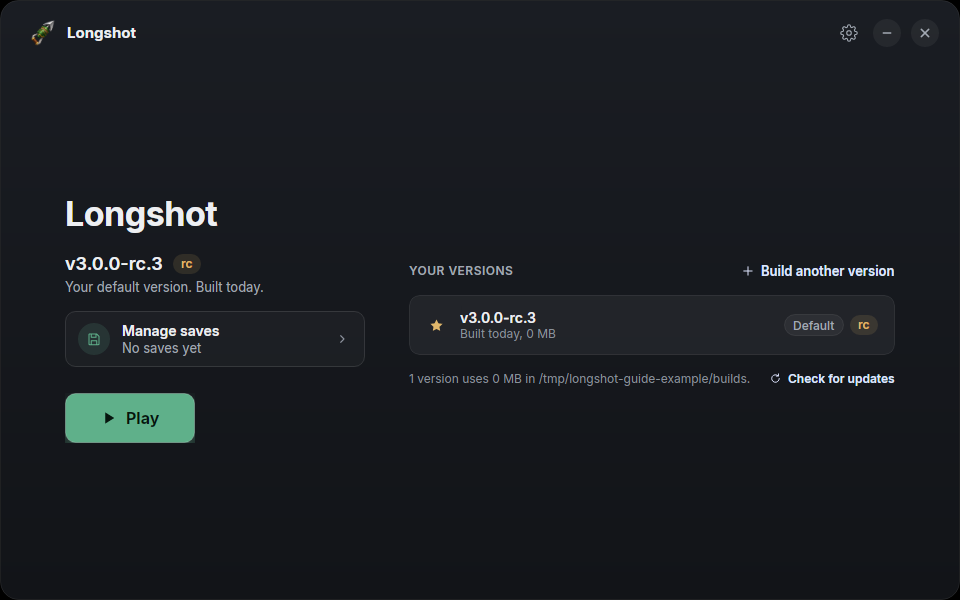
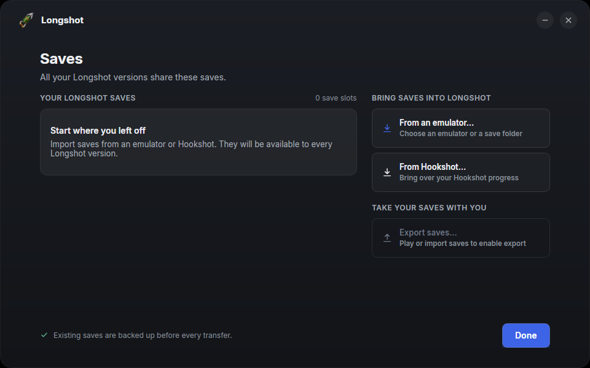
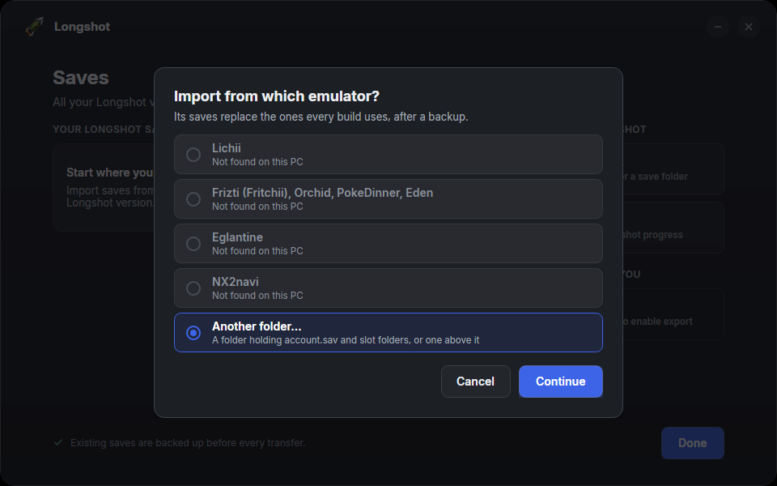
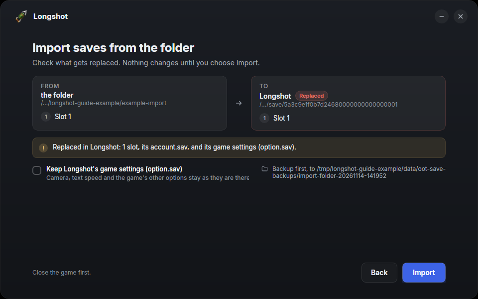

# Moving your saves

Longshot uses the same save files as Hookshot and supported emulators. Use the **Longshot Launcher** to import or export saves.
Open **Manage saves** on the launcher's home page, under the default version.
The pictures show Launcher **nightly-52-b1d9f7a9** on Linux with example data; older releases may look different.

<figure class="guide-screenshot">
<a href="images/guide/launcher-manage-saves.png">



</a>
<figcaption>UI-only example from Launcher nightly-52-b1d9f7a9 on Linux, with a synthetic registered build.</figcaption>
</figure>

The launcher **backs up existing saves before replacing them**. Close Longshot, Hookshot and any emulators first;
the launcher won't copy while they are running. Copying replaces the destination's slots; it does not merge saves.

## Before you start

1. **Save and quit.** Save in the game, then quit it.
2. **Pick your adventure.**

<figure class="guide-screenshot">
<a href="images/guide/launcher-saves.png">



</a>
<figcaption>UI-only example from Launcher nightly-52-b1d9f7a9 on Linux, with no saves loaded.</figcaption>
</figure>

## Import a save into Longshot

### From an emulator

1. Close Longshot and the emulator. With the pictured nightly Launcher, you can import before your first game launch.
   If you use Launcher v1.0.0-rc.3, start Longshot once and save first, then quit it.
2. On the **Saves** page, choose **From an emulator…**. The launcher lists the emulators whose saves it found on this
   PC (Lichii, Eden, Eglantine, Orchid, PokeDinner, Frizti and NX2navi), with their slots and save times.
3. Pick the emulator and, if asked, the profile you play on. If it isn't listed (a portable install, a copy on another
   drive), select **Another folder…**. Press **Continue**, then pick the save folder, or a folder that holds one.

   <figure class="guide-screenshot">
   <a href="images/guide/launcher-import.png">

   

   </a>
   <figcaption>UI-only example from Launcher nightly-52-b1d9f7a9 on Linux.</figcaption>
   </figure>

4. Check **FROM**, **TO** and the replacement warning on the confirmation screen. Choose whether to keep the
   destination's game settings, and check the backup location.

   <figure class="guide-screenshot">
   <a href="images/guide/launcher-import-confirm.png">

   

   </a>
   <figcaption>UI-only example from Launcher nightly-52-b1d9f7a9 on Linux.</figcaption>
   </figure>

   When the source and destination are correct, press **Import**.
5. Start Longshot and load your slot.

### From Hookshot

Hookshot, the project Longshot continues, writes the same save files, so a Hookshot adventure carries on in Longshot.

1. On the **Saves** page, choose **From Hookshot…**. (When the launcher finds Hookshot saves, its home page also
   offers this once.)
2. Pick the save. The launcher looks where Hookshot keeps them; for anywhere else, use **Choose a folder…**.
3. If Longshot already has a save, the launcher asks before replacing it, backs it up whole, and tells you where.

Hookshot's own saves stay exactly as they were: nothing in its folders is moved or changed.

## Export a save from Longshot

1. Start the emulator you're going to, save once so its folders exist, then quit it. Close Longshot too.
2. On the **Saves** page, choose **Export saves…**, and pick the emulator, or **Another folder…** for anywhere else.
   Press **Continue** and choose a folder if asked.
3. Check the source and destination on the confirmation screen, then press **Export**.
4. Open the emulator and load your slot.

The emulator's save is backed up before it's replaced. The launcher doesn't export to Hookshot; the
[save script](#for-advanced-users-the-save-script) can.

## Between Longshot builds

- **The pictured nightly Launcher:** builds started through it share saves on Windows, Linux and Steam Deck. There is
  nothing to copy between builds. On Windows it brings older builds' saves together, keeps the newest and backs up
  each one first; read the launcher's notice to see which save it kept.
- **Launcher v1.0.0-rc.3 on Windows:** each build keeps its own saves. On the destination build's **Saves** page, choose
  **From another version…**. A new build can take the default build's saves through **Move my saves** in the wizard.
- **Linux and Steam Deck:** saves are shared in both versions.

## Where Longshot keeps them

| Installation | Your saves | The launcher's backups |
|---|---|---|
| Windows, pictured nightly Launcher, installed | `%APPDATA%\Longshot\save\` (normally `%USERPROFILE%\AppData\Roaming\Longshot\save\`) | `%LOCALAPPDATA%\Longshot\oot-save-backups` |
| Windows, pictured nightly Launcher, portable | `LongshotLauncher-data\user\save\` beside the launcher | `LongshotLauncher-data\save-backups\` beside the launcher |
| Windows, Launcher v1.0.0-rc.3 or game started directly without `--user` | `<game folder>\user\save\` (the game folder is `%USERPROFILE%\Games\Longshot` unless you chose another) | `%LOCALAPPDATA%\Longshot\oot-save-backups`; a portable launcher's backups are in `LongshotLauncher-data\save-backups\` beside it |
| Linux and Steam Deck | `~/.local/share/longshot/save/` | `~/.local/share/longshot/save-backup/`, also `scripts/longshot_saves.py`'s (older backups, from a launcher before [LongshotLauncher#80](https://git.magicbean.dev/MagicBeanDev/LongshotLauncher/pulls/80) or the script before [LongshotLauncher#188](https://git.magicbean.dev/MagicBeanDev/LongshotLauncher/issues/188), stay in `~/.local/share/oot-save-backups`) |

On Windows with the installed nightly Launcher, paste `%APPDATA%\Longshot\save\` into File Explorer's address bar
and press **Enter**. `%APPDATA%` is your **Roaming** folder; `%LOCALAPPDATA%` is **Local**, where the launcher keeps backups.
Starting `longshot.exe` directly without `--user` does not use the launcher's shared save folder.

`save-work/<user id>/` beside `save/` is the game's working copy: the game writes there, and a finished save goes into
`save/` one file at a time. A program reading during a save can see files from different saves; copy the folder while the
game is closed. You can delete the working copy while the game is closed. Leave `<user id>.journal` beside it alone: when
it is there, a save was interrupted while it was being put in place, and the next start finishes it. If recovery fails,
the game cannot mount the save until recovery succeeds. `<user id>.lock` marks the
running game that uses the folder; it holds nothing and may stay. Save tools copy only `save/`.

To keep your own copy, copy the save folder while the game is closed. Keep save files private.

## Where the emulators keep them

| Program | Linux | Windows |
|---|---|---|
| [Lichii](https://github.com/zortos293/Lichii) | `~/.local/share/lichii/` + Eden's save path (before build 150: `~/.local/share/eden/`) | `%APPDATA%\lichii\` + Eden's save path (before build 150: `%APPDATA%\eden\`) |
| [Frizti (Fritchii)](https://github.com/Frizti/Lichii), a Lichii fork | `~/.local/share/eden/` + Eden's save path | `%APPDATA%\eden\` + Eden's save path |
| Eden | `~/.local/share/eden/` + Eden's save path | `%APPDATA%\eden\` + Eden's save path |
| [Orchid](https://github.com/MythosOfs/Orchid) | `~/.local/share/eden/` + Eden's save path | `%APPDATA%\eden\` + Eden's save path |
| [PokeDinner](https://git.eden-emu.dev/Franseven/PokeDinner-a-Eglantine-Fork) | `~/.local/share/eden/` + Eden's save path | `%APPDATA%\eden\` + Eden's save path |
| [Eglantine](https://github.com/Djihads80/Eglantine) | `~/.local/share/eglantine/` + Eden's save path | `%APPDATA%\eglantine\` + Eden's save path |
| [NX2navi](https://github.com/tangerineturtle1/NX2navi) | `<game folder>/profile/save/<account>/` (its AppImage builds into `~/Games/Ocarina`) | `<game folder>\profile\save\<account>\` (its launcher's game folder is `%LOCALAPPDATA%\Programs\NX2navi\game`, or `C:\Games\Ocarina`, unless you chose another) |

Eden's save path, under that folder: `nand/user/save/0000000000000000/<profile id>/0400486024DEC000/`, where
`<profile id>` is the emulator's user profile you play with. Newer Eden code uses
`nand/user/save/account/<profile>/0400486024DEC000/0/` first when that folder exists.

- **Frizti, Orchid and PokeDinner use Eden's folder**: a save there is the same save in all of them and in Eden. Eglantine has its
  own, and so has Lichii since its build 150; the save script looks in Lichii's folder first and uses Eden's when it has no save.
- **Portable installs** keep a `user` folder beside the emulator instead of the paths above. The save script doesn't
  look there: point it at the folder with `--from` or `--to`.
- **NX2navi** writes a save to `profile/save-tx` first and moves it into place after. Start and quit NX2navi before
  copying while something waits there.
- On Linux, `$XDG_DATA_HOME` replaces `~/.local/share` when it is set.
- Ryujinx and its forks don't run this game.

## Undo a copy

Each copy's backup is a folder in the backups folder above, named by when it was made. Close the game, then put that
folder's contents back into the save folder, the whole set of slots at once. If something looks wrong, stop before
copying again and [ask on Discord](https://discord.gg/magicbean), without posting your save files.

## For advanced users: the save script

Longshot has the same transfers on the command line: [`scripts/longshot_saves.py`](../../scripts/longshot_saves.py), which needs only
Python 3. It also exports to Hookshot, handles custom folders, portable installs and several profiles, and previews a
copy with `--dry-run`:

```sh
python -I scripts/longshot_saves.py list              # every save it finds, its slots and when each was saved
python -I scripts/longshot_saves.py import lichii     # Lichii -> Longshot
python -I scripts/longshot_saves.py export lichii     # Longshot -> Lichii
```

For a portable emulator or any other folder, name it with `--from` or `--to`. The developer page on
[saves](../dev/reference/saves.md) has every command and option, and how the script finds and copies saves.
